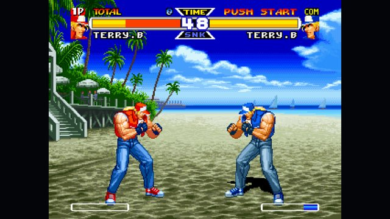
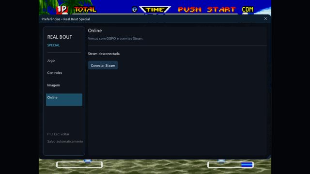

# Fúria Fatal RBS

**Fúria Fatal RBS** é um projeto comunitário e não oficial para Windows que usa a versão Neo Geo CD de **Real Bout Fatal Fury Special** (Fatal Fury Real Bout Special). O jogo original é fornecido pelo usuário em formato CHD.

> **Não é uma recompilação nativa do jogo.** O projeto utiliza emulação.

> **Jurídico e licenças.** Consulte os [avisos e condições de redistribuição](JURIDICO.md), incluindo o que o pacote Windows contém e as condições de cada dependência.

## Principais diferenciais

- **Widescreen**.
- **Músicas da versão Neo Geo CD, com áudio de CD**.
- **Netplay via Steam** para partidas online.
- **Placar automático**.
- Salvamento local pelo jogador. O pacote atualizado inicia sem estado pré-carregado.
- **Launcher gráfico para Windows**, com seleção de ROM e BIOS e botão PLAY.
- Menu de opções acessível pela tecla **F1**.

## Capturas de tela

## Requisitos

- Windows.
- Steam em execução para os recursos de Netplay.
- Imagem **CHD** compatível do jogo, fornecida pelo usuário.
- BIOS **neocdz.zip** e **neogeo.zip**, fornecidas pelo usuário.
- Componentes de execução compatíveis, conforme a distribuição autorizada.

**ROM/CHD e BIOS não são fornecidas neste repositório.** Use apenas arquivos que você tenha direito de utilizar.

## Instalação e execução

1. Obtenha uma distribuição do launcher e seus componentes autorizados.
2. Extraia o pacote completo, preservando a estrutura de pastas.
3. Execute `RealBoutLauncher.exe`.
4. Selecione a imagem CHD e as duas BIOS solicitadas.
5. Clique em **PLAY**.
6. Para acessar opções dentro do jogo, pressione **F1**. Para jogar online, mantenha a Steam aberta.

## Distribuição e código-fonte

O repositório contém o [código-fonte do launcher](src/RealBoutLauncher.cpp), [código e patches recuperados da V5](recovered-v5/README.md), documentação e [licenças de terceiros](THIRD_PARTY_LICENSES/). O projeto utiliza emulação; o launcher não recompila nativamente o jogo original.

A [auditoria da V6](docs/VALIDACAO_PENDENCIAS_V6.md) vincula o núcleo à árvore de compilação original e documenta a reprodução do player a partir do backup histórico. A cópia preparada para distribuição inclui o banner Fúria Fatal RBS e avisos de terceiros. CHD, BIOS e savestate pré-carregado ficam fora do pacote.

A Release `v1.0.0` segue em rascunho com seus anexos históricos. O pacote atualizado e o arquivo de fontes auditados foram preparados separadamente.

## Estado dos testes

O pacote sem savestate passou em boot, alternância 320 → 426 → 320, áudio, save local e rollback GGPO. O launcher atualizado iniciou em uma pasta isolada. O título da janela foi verificado no executável compilado.

Este é um projeto comunitário não oficial, sem afiliação declarada com os titulares da franquia.
